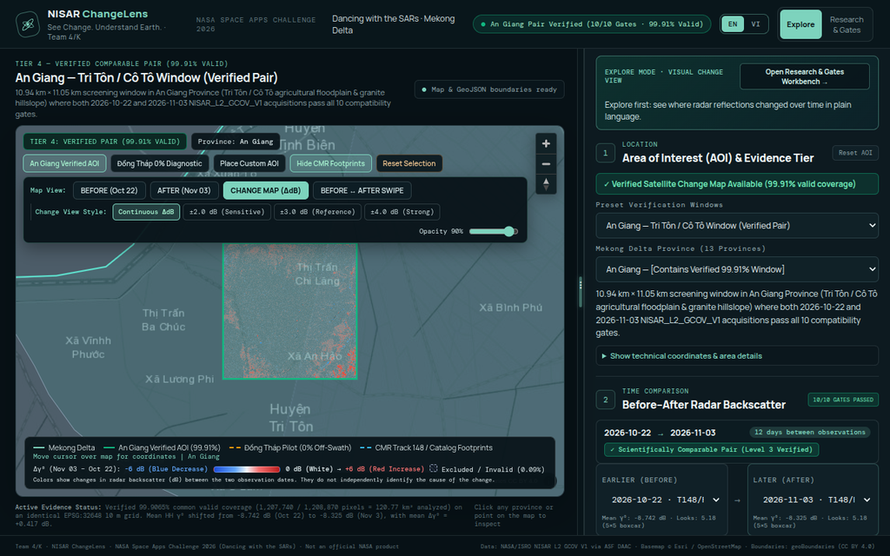
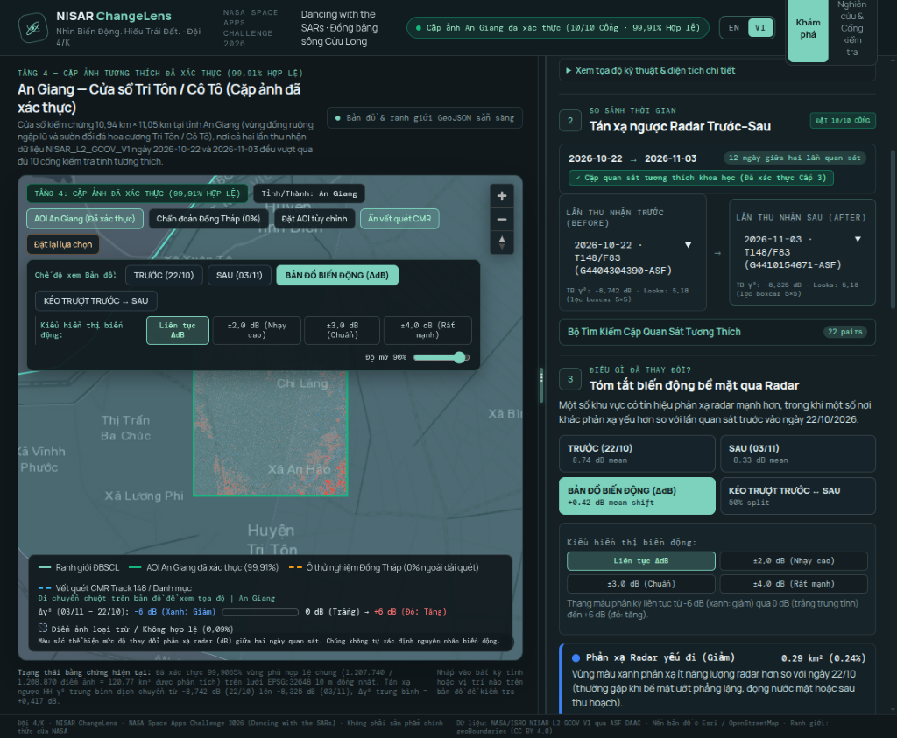
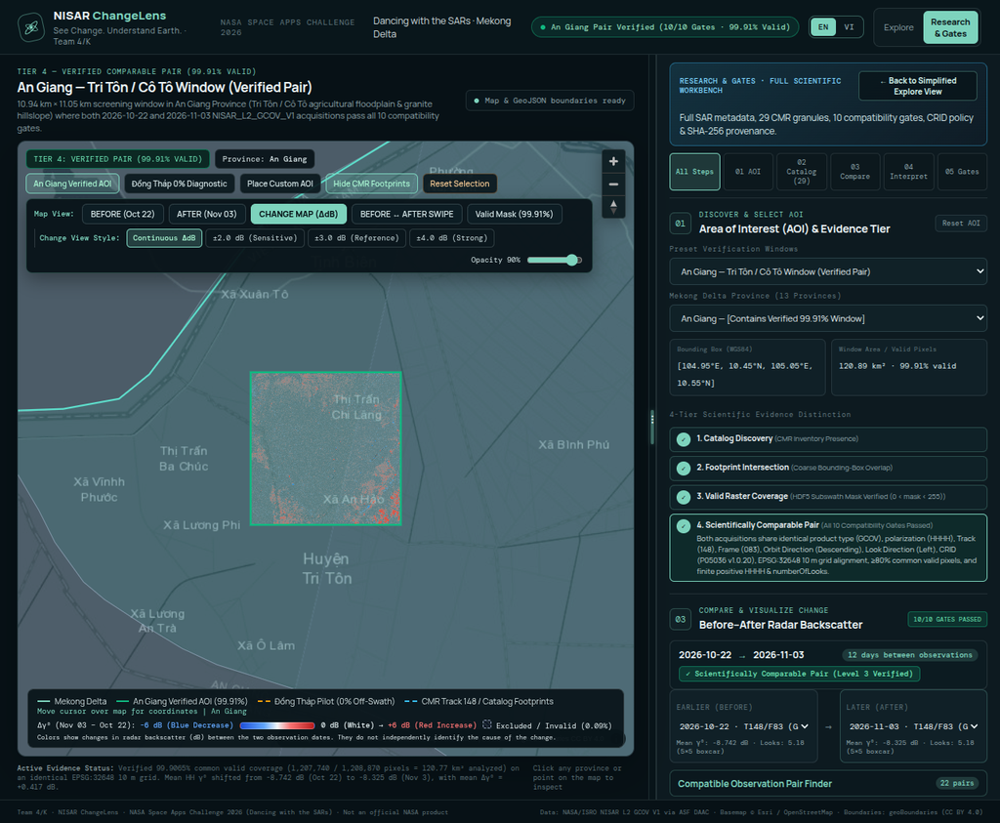
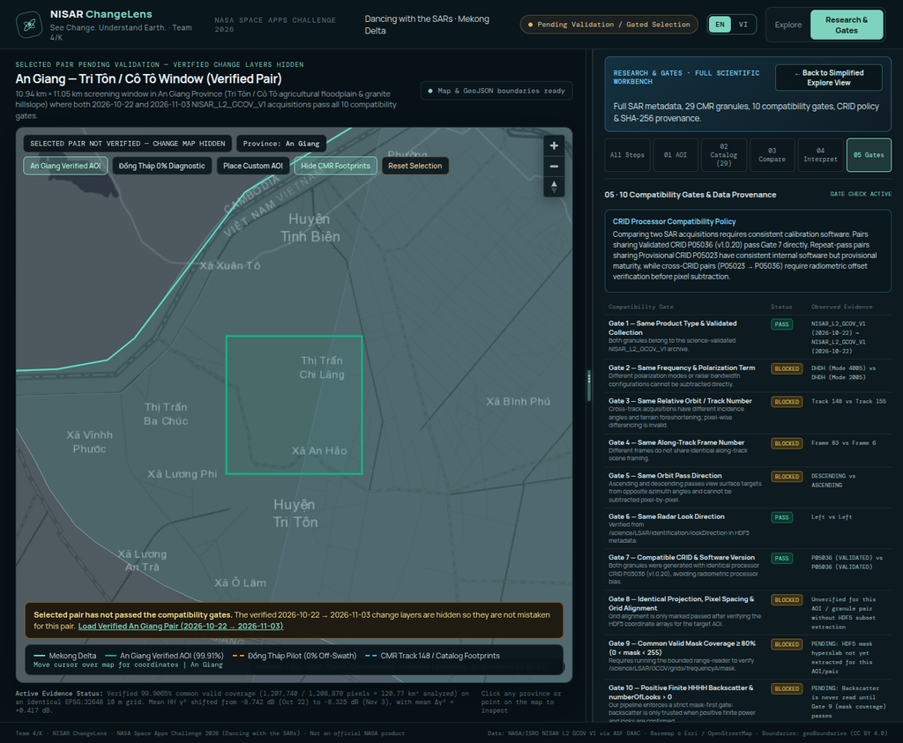

# NISAR ChangeLens

> **See Change. Understand Earth.** · *Nhìn Biến Động. Hiểu Trái Đất.*  
> **NASA Space Apps Challenge 2026** — Challenge: **Dancing with the SARs**  
> **Team**: **4/K** (Local Event: Hanoi, Vietnam)

[-10b981)](#15-testing-and-verification)
[-38bdf8)](#8-verified-scientific-case-study-an-giang)
[-7dd3bd)](#6-solution-and-key-features)
[](LICENSE)

---

## Quick Start (Run Website Locally — No Credentials Needed)

**Requirement**: [Node.js](https://nodejs.org/) `v20.19+` or `v22.12+` LTS (`v22.12+` recommended). No backend server or NASA Earthdata login is required.

```bash
cd frontend
npm install
npm run dev
```

Open the local URL printed in your terminal (typically **`http://localhost:5173/`**). Press `Ctrl + C` in the terminal to stop the server.

> **New to NISAR ChangeLens?** Read the step-by-step [**Complete User Guide (`docs/USER_GUIDE.md`)**](docs/USER_GUIDE.md) for installation, map controls (`Before`, `After`, `Change Map`, `Swipe`), threshold presets (`±2 / ±3 / ±4 dB`), scientific interpretation, and troubleshooting.

---

## Table of Contents

1. [Project Title & Tagline](#1-project-title-and-tagline)
2. [NASA Space Apps 2026 Challenge](#2-nasa-space-apps-2026-challenge)
3. [Team 4/K](#3-team-4k)
4. [Project Overview (EN & VI)](#4-project-overview)
5. [Problem Statement](#5-problem-statement)
6. [Solution and Key Features](#6-solution-and-key-features)
7. [Screenshots and Demo Status](#7-screenshots-and-demo-status)
8. [Verified Scientific Case Study: An Giang](#8-verified-scientific-case-study-an-giang)
9. [Scientific Methodology & QA Summary](#9-scientific-methodology-summary)
10. [Data Sources and Attribution](#10-data-sources-and-attribution)
11. [Technology Stack & Dependencies](#11-technology-stack)
12. [Team Members and Contributions](#12-team-members-and-contributions)
13. [AI Tools and AI-Use Disclosure](#13-ai-tools-and-ai-use-disclosure)
14. [Installation and Reproduction Instructions](#14-installation-and-reproduction-instructions)
15. [Testing and Verification](#15-testing-and-verification)
16. [Known Limitations & Scientific Warnings](#16-known-limitations)
17. [License and Third-Party Notices](#17-license-and-third-party-notices)
18. [Acknowledgements & Documentation Index](#18-acknowledgements)

---

## 1. Project Title and Tagline

- **Product Name**: **NISAR ChangeLens**
- **Tagline**: *See Change. Understand Earth.* (*Nhìn Biến Động. Hiểu Trái Đất.*)
- **Primary Study Region**: Mekong Delta, Vietnam (*Đồng bằng sông Cửu Long — ĐBSCL*), featuring a pixel-verified `NISAR_L2_GCOV_V1` case study in **An Giang Province (`[104.95, 10.45, 105.05, 10.55]`)** and a fail-closed off-swath diagnostic window in **Đồng Tháp Province (`[105.45, 10.60, 105.55, 10.70]`)**.

---

## 2. NASA Space Apps 2026 Challenge

- **Official Challenge**: **Dancing with the SARs** (NASA Space Apps Challenge 2026)
- **Challenge Goal**: Make Synthetic Aperture Radar (SAR) Earth observation data—specifically from the newly commissioned **NASA-ISRO SAR (NISAR)** mission—accessible, interpretable, and scientifically trustworthy for researchers, local planners, educators, and non-specialists.

---

## 3. Team 4/K

- **Official Team Name**: `4/K`
- **Local Event**: Hanoi, Vietnam
- **Official Space Apps Team Roster**: https://www.spaceappschallenge.org/2026/find-a-team/4k/?tab=members
- **Registered Members**:
  - **Phạm Thành Trung** (*Team Owner*)
  - **Lý Chấn Hưng** (*Member*)

---

## 4. Project Overview

### English Overview
**NISAR ChangeLens** is a serverless, bilingual (`EN | VI`) geospatial web application and bounded HDF5 data pipeline designed to explore L-band radar backscatter variability in Vietnam's **Mekong Delta** using authentic **NASA-ISRO SAR (`NISAR_L2_GCOV_V1`)** observations.

Rather than treating every catalog bounding-box overlap as valid imagery or labeling every radar brightness change as "flooding," **NISAR ChangeLens** enforces a **4-Tier Evidence Hierarchy**, **10 Automated Compatibility Gates**, and a **3-Level Scientific Interpretation Guardrail**:
- **Intended Users**: Environmental researchers, agricultural & water-resource planners in the Mekong Delta, educators, journalists, and citizens who need to inspect cloud-penetrating radar observations without downloading 6 GB HDF5 granules or writing specialized GIS scripts.
- **What Is Demonstrated by Real Verified Data vs. Catalog / Diagnostic Examples**:
  1. **Real Verified Pixel-Level Comparison (Tier 4)**: Demonstrated on the `120.77 km²` common valid window in **An Giang (`[104.95, 10.45, 105.05, 10.55]`)** between **2026-10-22 (`G4404304390-ASF`)** and **2026-11-03 (`G4410154671-ASF`)** (`99.9065%` valid coverage, all 10 gates passed).
  2. **Real Off-Swath Diagnostic Rejection (Tier 3 Fail-Closed)**: Demonstrated on the **Đồng Tháp Pilot Bbox (`[105.45, 10.60, 105.55, 10.70]`)**, where actual HDF5 extraction proved that `100%` of the `1,212,165` pixels have `mask = 255` (`0.00%` valid) because the tilted Descending Track 148 radar swath passes west of that window.
  3. **Regional Catalog & Footprint Discovery (Tiers 1 & 2)**: Demonstrated across all **29 authentic NASA CMR granules** (`11` Validated `NISAR_L2_GCOV_V1` + `18` Provisional `NISAR_L2_GCOV_PROVISIONAL_V1`) and all **13 Mekong Delta provinces**. We explicitly do **not** claim pixel-level validation for the remaining 11 provinces or unextracted granules.

### Tóm tắt Dự án (Tiếng Việt)
**NISAR ChangeLens** là ứng dụng bản đồ web tĩnh song ngữ (**Tiếng Anh `EN` | Tiếng Việt `VI`**) kết hợp với bộ trích xuất dữ liệu HDF5 có giới hạn dung lượng (`250 MB`), giúp trực quan hóa và kiểm chứng biến động tán xạ ngược radar băng tần L từ vệ tinh **NASA-ISRO NISAR (`NISAR_L2_GCOV_V1`)** tại **Đồng bằng sông Cửu Long**. Hệ thống áp dụng **4 tầng bằng chứng dữ liệu**, **10 cổng kiểm tra tính tương thích vật lý**, và **3 cấp độ diễn giải khoa học** (tách biệt rõ số đo $\Delta\gamma^0\text{ dB}$ thực nghiệm với các giả thuyết vật lý như phản xạ gương trên mặt nước hay tán xạ kép `double-bounce` trên lúa/tràm ngập nước), tuyệt đối không tuyên bố ngập lụt khi thiếu dữ liệu quang học và thủy văn kiểm chứng.

---

## 5. Problem Statement

1. **The Tropical Cloud Blindspot**: During the Mekong Delta monsoon and flood season, persistent cloud cover blocks optical satellites for weeks at a time. L-band SAR ($\lambda \approx 24\text{ cm}$) penetrates clouds and vegetation canopies day and night.
2. **The 6 GB HDF5 & Swath-Geometry Barrier**: Single NISAR L2 GCOV granules are **5.8 GB to 6.4 GB** remote HDF5 files. Because satellite orbit tracks are tilted relative to north-up UTM grids, ~37% of each granule's bounding box consists of off-swath NoData padding (`mask = 255`). Naive catalog tools falsely report "coverage" over areas that contain zero valid radar pixels.
3. **The Misinterpretation Risk**: Subtracting two incompatible radar passes (different orbit directions, tracks, or processing versions) or equating every backscatter change ($\Delta\gamma^0$) with "flooding" leads to scientifically invalid conclusions—especially in L-band SAR, where open water *decreases* backscatter (specular reflection) while water beneath emergent rice or wetland stems *increases* backscatter (double-bounce scattering).

---

## 6. Solution and Key Features

1. **Dual-Audience Experience (`Explore` vs. `Research & Gates` Modes)**:
   - **Explore Mode (General Users)**: Visual-first 4-section workflow (**1. Location → 2. Time Comparison → 3. What Changed? → 4. Explore More**) with readable typography, plain-language radar backscatter summaries, visual change cards, and progressive disclosure accordions.
   - **Research & Gates Mode (Researchers)**: Full 5-step scientific workbench (**01 AOI → 02 Catalog → 03 Compare → 04 Interpret → 05 Gates**) exposing the 4-Tier Evidence Ladder, 29-granule catalog filters, quantitative dB distributions, CRID Processor Policy (`P05036` vs. `P05023`), 10-gate verification table, and SHA-256 provenance.
   - Persists mode selection in `localStorage` (`nisar-changelens-mode`) while preserving AOI, observation pair, active layer, and language.
2. **Resizable Map / Analysis Layout (`workspace-splitter`)**:
   - Interactive vertical splitter between the MapLibre GL map and the Analysis Sidebar (`340px–720px` bounds, keyboard arrow support, double-click/button reset to `440px`, persisted in `localStorage` `nisar-changelens-rail-width`) with automatic `ResizeObserver` `map.resize()` integration and stacked mobile layout (`<= 860px`).
3. **Interactive Change Map & Exploratory Threshold Controls (`MapStage.tsx`)**:
   - Instant switching between **BEFORE (Oct 22)**, **AFTER (Nov 03)**, **CHANGE MAP ($\Delta\text{dB}$)**, and **BEFORE $\leftrightarrow$ AFTER SWIPE**.
   - Includes a diverging radiometric color scale (`-6 dB` Blue Decrease $\rightarrow$ `0 dB` Neutral White $\rightarrow$ `+6 dB` Red Increase), excluded/invalid pixel indicator (`0.09%`), adjustable opacity slider + `Reset (90%)`, and exploratory display thresholds (**Continuous $\Delta\text{dB}$**, **$\pm 2.0\text{ dB}$ Sensitive**, **$\pm 3.0\text{ dB}$ Reference Baseline**, **$\pm 4.0\text{ dB}$ Strong**).
4. **Automatic Compatible-Pair Discovery & 3-Level Compatibility Classification**:
   - Automatically normalizes chronological selection (`Earlier` $\rightarrow$ `Later`) and discovers **22 repeat-pass candidate pairs** across the **29 authentic NASA CMR granules** (`Track 148, 047, 083, 155`), distinguishing **Level 3 (Raster-Verified Compatible Pair)**, **Level 2 (Geometrically Compatible Candidate)**, and **Level 1 (Catalog Candidate Only)**.
5. **3-Level Scientific Interpretation & Deterministic Q&A (`04 Interpret`)**:
   - Distinguishes **Level 1 (Measured Radar Change)**, **Level 2 (Candidate Physical Mechanisms)**, and **Level 3 (Supported Conclusions & Missing Evidence)**, paired with a deterministic, citation-backed Q&A inspector.
6. **10 Compatibility Gates, HTTP Range Budget Ledger & SHA-256 Provenance (`05 Gates`)**:
   - Exposes the 10-gate verification table, the resumable **HTTP Range Byte-Budget Ledger** (`33,812,717 / 250,000,000 bytes` = `13.53%` used across two stages), and **SHA-256 checksums** for all 11 verified output files.
7. **Complete Bilingual (`EN | VI`) Interface (`frontend/src/i18n/`)**:
   - Instantaneous switching between **English (`EN`)** and **Vietnamese (`VI`)** in the top header without page reload, preserving all map, AOI, mode, filter, and comparison states and persisting in `localStorage` (`nisar-changelens-lang`).

---

## 7. Screenshots and Demo Status

### Verified Application Screenshots (`docs/screenshots/`)

| Explore Mode & Visual Change Map (`EN`) | Vietnamese (`VI`) Explore & Change Map |
| :---: | :---: |
|  |  |
| **Research & Gates Mode (Full Workbench)** | **10 Compatibility Gates & CRID Policy** |
|  |  |

Complete set of 11 verified UX & Scientific Comparison screenshots in [`docs/screenshots/`](docs/screenshots/):
- [`01_explore_mode.png`](docs/screenshots/01_explore_mode.png) — Visual-first **Explore** mode with Change Map ($\Delta\gamma^0\text{ dB}$) and diverging legend.
- [`02_research_gates_mode.png`](docs/screenshots/02_research_gates_mode.png) — **Research & Gates** mode with 5-step workbench and 4-Tier Evidence Ladder.
- [`03_resized_layout.png`](docs/screenshots/03_resized_layout.png) — Resized Map / Sidebar layout (`584px` sidebar via draggable splitter + `Reset Width` button).
- [`04_before_visualization.png`](docs/screenshots/04_before_visualization.png) — **Before (`2026-10-22`)** calibrated HH $\gamma^0$ backscatter visualization.
- [`05_after_visualization.png`](docs/screenshots/05_after_visualization.png) — **After (`2026-11-03`)** calibrated HH $\gamma^0$ backscatter visualization.
- [`06_change_visualization.png`](docs/screenshots/06_change_visualization.png) — **Change Map ($\Delta\text{dB}$)** with threshold controls (`Continuous`, `±2.0 dB`, `±3.0 dB Reference`, `±4.0 dB`) and diverging colorbar.
- [`07_compatibility_failure_explore.png`](docs/screenshots/07_compatibility_failure_explore.png) — Simplified plain-language compatibility explanation in **Explore** mode.
- [`08_compatibility_report_research.png`](docs/screenshots/08_compatibility_report_research.png) — Detailed 10-Gate Compatibility Report & CRID Policy (`P05036` vs `P05023`) in **Research** mode.
- [`09_english_interface.png`](docs/screenshots/09_english_interface.png) — **English (`EN`)** interface with the on-map Before $\leftrightarrow$ After swipe divider (drag to compare `2026-10-22` and `2026-11-03`).
- [`10_vietnamese_interface.png`](docs/screenshots/10_vietnamese_interface.png) — **Vietnamese (`VI`)** localized interface (`Khám phá` & `Tóm tắt biến động bề mặt qua Radar`).
- [`11_mobile_responsive.png`](docs/screenshots/11_mobile_responsive.png) — **Mobile Responsive (`390x844`)** stacked layout.

### Public Demo Status & Local Walkthrough
- **Honest Deployment Status**: No public cloud URL is currently hosted prior to owner publication approval. The complete interactive demo runs locally out-of-the-box (`npm run preview`) with **zero credentials required** using the pre-packaged verified An Giang dataset in `frontend/public/data/verified-angiang/`.
- See [`docs/DEMO_GUIDE.md`](docs/DEMO_GUIDE.md) for the step-by-step **3-Minute Judge Demonstration Script**.

---

## 8. Verified Scientific Case Study: An Giang

All pixel-level comparison results in this release come from the verified **An Giang Pilot Window (`[104.95, 10.45, 105.05, 10.55]`, Tri Tôn / Cô Tô agricultural floodplain & granite hillslope)** — **not** the entire Mekong Delta:

| Parameter / Metric | Verified Value | Source / Evidence |
| :--- | :--- | :--- |
| **Dataset & Collection** | `NISAR_L2_GCOV_V1` (`C3622241360-ASF`, Validated V1) | NASA CMR / ASF DAAC |
| **Earlier Acquisition (`Before`)** | **`2026-10-22`** (`11:31:40 UTC`) · Concept ID: **`G4404304390-ASF`** | `NISAR_L2_PR_GCOV_033_148_D_083_4005_DHDH_A_20261022T113140_20261022T113214_P05036_N_F_J_001` |
| **Later Acquisition (`After`)** | **`2026-11-03`** (`11:31:37 UTC`) · Concept ID: **`G4410154671-ASF`** | `NISAR_L2_PR_GCOV_034_148_D_083_4005_DHDH_A_20261103T113137_20261103T113215_P05036_N_F_J_001` |
| **Viewing Geometry & Processor** | **Track `148`, Frame `083`**, **Descending**, **Left-looking**, **`HHHH`**, **CRID `P05036`** (`v1.0.20`) | Gates 1–7 **PASS** |
| **Native Raster Grid** | **`EPSG:32648`** (UTM 48N), **`10 m × 10 m`** spacing, shape **`1105 × 1094`** (`1,208,870` total pixels) | Gate 8 **PASS** (`0` resampling required) |
| **Common Valid Coverage** | **`1,207,740 / 1,208,870` pixels (`99.9065%`)** = **`120.77 km²`** analyzed (`1,130` px excluded on Núi Tô radar shadow) | Gates 9 & 10 **PASS** |
| **Before Mean $\gamma^0_{\text{HH}}$ ($5\times 5$ boxcar)** | **`-8.742 dB`** (median `-7.346 dB`; raw unsmoothed pixel mean `-9.793 dB`) | `verified_pair_manifest.json` |
| **After Mean $\gamma^0_{\text{HH}}$ ($5\times 5$ boxcar)** | **`-8.325 dB`** (median `-7.297 dB`; raw unsmoothed pixel mean `-9.317 dB`) | `verified_pair_manifest.json` |
| **Mean Backscatter Change ($\Delta\gamma^0_{\text{dB}}$)** | **`+0.417 dB`** (median `+0.240 dB`, std `1.277 dB`, 5th–95th percentile `[-1.186, +2.663] dB`) | $\Delta\gamma^0_{\text{dB}} = \text{After}_{\text{dB}} - \text{Before}_{\text{dB}}$ |
| **Strong Decrease ($\Delta\gamma^0 \le -3.0\text{ dB}$)** | **`0.29 km²`** (`2,905` pixels · `0.24%` of valid window) | Blue class in `change_classes.png` |
| **Stable ($-3.0\text{ dB} < \Delta\gamma^0 < +3.0\text{ dB}$)** | **`116.09 km²`** (`1,160,945` pixels · `96.13%` of valid window) | Neutral class in `change_classes.png` |
| **Strong Increase ($\Delta\gamma^0 \ge +3.0\text{ dB}$)** | **`4.39 km²`** (`43,890` pixels · `3.63%` of valid window) | Red class in `change_classes.png` |

---

## 9. Scientific Methodology Summary

Full mathematical and algorithmic details are documented in [`docs/SCIENTIFIC_METHODOLOGY.md`](docs/SCIENTIFIC_METHODOLOGY.md) and audited in [`docs/FINAL_SCIENTIFIC_QA.md`](docs/FINAL_SCIENTIFIC_QA.md):

1. **Radiometric Quantity ($\gamma^0$ Power, Not $\sigma^0$)**:
   - NISAR L2 GCOV diagonal terms (`/science/LSAR/GCOV/grids/frequencyA/HHHH`) represent terrain-flattened **gamma-0 ($\gamma^0$) linear backscatter power**, not ellipsoid sigma-0 ($\sigma^0$) or amplitude.
2. **Validity Mask & Radiometric Predicate (`0 < mask < 255`)**:
   - In GCOV `mask` (`uint8`), `1..254` indicates valid subswath ID, `0` indicates invalid/radar shadow, and `255` indicates off-swath NoData fill.
   - `numberOfLooks` is inspected as a radiometric quality check (`numberOfLooks > 0`, mean `5.18` looks) and is **never** used as a substitute for `mask`.
   - A pixel is valid on a given date iff `(mask > 0) & (mask < 255) & isfinite(HHHH) & (HHHH > 0) & isfinite(numberOfLooks) & (numberOfLooks > 0)`.
3. **Validity-Aware $5\times 5$ Boxcar Speckle Filtering in Linear Power**:
   - Speckle suppression is performed in the **linear power domain** *before* logarithmic conversion using a normalized validity-aware $5\times 5$ boxcar filter:
     $$\overline{\gamma^0}(i,j) = \frac{\sum_{(u,v)\in \mathcal{N}_{5\times 5}(i,j)} V(u,v)\,\gamma^0(u,v)}{\sum_{(u,v)\in \mathcal{N}_{5\times 5}(i,j)} V(u,v)}$$
     rejecting windows where valid fraction $\le 0.20$ ($<5/25$ valid pixels).
4. **Decibel Conversion & Signed Change**:
   $$\gamma^0_{\text{dB}} = 10\log_{10}\!\left(\overline{\gamma^0}\right), \qquad \Delta\gamma^0_{\text{dB}} = \gamma^0_{\text{After, dB}} - \gamma^0_{\text{Before, dB}}$$
   evaluated strictly on the **common valid mask** (`joint_valid = valid_before & valid_after`).
5. **Documented Scientific QA Warnings (`W-1` & `W-2`)**:
   - **`W-1` (Per-Date vs. Joint-Mask Neighborhood Support near `mask = 0`)**: Because `pipeline/extract_verified_pair.py` normalizes `filt0` over `valid0` and `filt1` over `valid1` before applying `joint_valid`, the `1,019` jointly valid pixels (`0.084%` of the AOI) whose $5\times 5$ window touches one of the `86` single-date `mask = 0` pixels around Núi Tô hill average over $N$ vs. $N-1$ neighbors. Independent recalculation in `float64` applying `joint_valid` prior to filtering confirms `0.000 dB` change to mean (`+0.417 dB`) and median (`+0.240 dB`) $\Delta\gamma^0_{\text{dB}}$ and at most a `0.01 km²` shift in class areas (`0.28 / 116.12 / 4.38 km²` vs. `0.29 / 116.09 / 4.39 km²`).
   - **`W-2` (Jensen's Inequality in Raw vs. Smoothed dB Means)**: In `verified_pair_manifest.json`, `granules_verified[].mean_db` records the unsmoothed single-pixel dB mean (`-9.793 dB` Before, `-9.317 dB` After), whereas `stats.before_db.mean` / `after_db.mean` records the $5\times 5$ boxcar-smoothed dB mean (`-8.742 dB` Before, `-8.325 dB` After). The ~`1.05 dB` difference on each date arises mathematically from Jensen's inequality ($\mathbb{E}[10\log_{10} P] < 10\log_{10}\mathbb{E}[P]$) when averaging Rayleigh speckle in linear power, and cancels in $\Delta\gamma^0_{\text{dB}}$.

---

## 10. Data Sources and Attribution

See [`docs/DATA_SOURCES.md`](docs/DATA_SOURCES.md) for the complete provenance register.

| Source | Provider | Exact Product / Dataset | Usage in Project | License / Terms |
| :--- | :--- | :--- | :--- | :--- |
| **NISAR Validated L2 GCOV** | NASA / ISRO via **ASF DAAC** | `NISAR_L2_GCOV_V1` (`G4404304390-ASF`, `G4410154671-ASF` + 9 catalog granules) | Verified An Giang pair comparison, Đồng Tháp off-swath diagnostic, and catalog inventory | NASA Open Data Policy |
| **NISAR Provisional L2 GCOV** | NASA / ISRO via **ASF DAAC** | `NISAR_L2_GCOV_PROVISIONAL_V1` (18 granules) | Catalog discovery & footprint visualization only (badged `PROVISIONAL`) | NASA Open Data Policy |
| **NASA CMR API** | NASA Earthdata | `cmr.earthdata.nasa.gov` (`granules.umm_json`) | Granule discovery (`29` Mekong Delta granules in `data/work/discovery.json`) | NASA Open Data Policy |
| **Administrative Boundaries** | **geoBoundaries** (William & Mary geoLab) | Vietnam ADM1 (`mekong_boundary.geojson`, `mekong_provinces.geojson`) | Mekong Delta & 13 provincial boundary layers | **CC BY 4.0** |
| **Web Basemap Tiles** | **Esri / ArcGIS Online** | `Canvas/World_Dark_Gray_Base` & `Reference` | Background map context in `MapStage.tsx` | Esri Basemap Terms (Attribution displayed) |

---

## 11. Technology Stack

Full dependency trees and license verifications are documented in [`docs/LICENSES_AND_ATTRIBUTION.md`](docs/LICENSES_AND_ATTRIBUTION.md) and [`docs/GITHUB_RELEASE_AUDIT.md`](docs/GITHUB_RELEASE_AUDIT.md).

### Frontend (`frontend/package.json`)
| Package | Verified Version | License | Purpose |
| :--- | :--- | :--- | :--- |
| `react` / `react-dom` | `19.3.1` | `MIT` | Interactive UI & bilingual state management |
| `maplibre-gl` | `6.18.0` | `BSD-3-Clause` | WebGL map, GeoJSON footprints & georeferenced SAR raster overlays |
| `typescript` | `7.0.2` | `Apache-2.0` | Static type checking (`tsc -b`) |
| `vite` / `@vitejs/plugin-react` | `8.3.8` / `6.3.0` | `MIT` | Static bundle compilation & local preview server |
| `vitest` / `jsdom` / `@testing-library/*` | `5.1.0` / `31.0.1` | `MIT` | 17 automated unit, data-contract & bilingual i18n tests |

### Python Pipeline (`requirements.txt`)
| Package | Verified Version | License | Purpose |
| :--- | :--- | :--- | :--- |
| `numpy` | `2.5.4` | `BSD-3-Clause` | Calibrated $\gamma^0_{\text{dB}}$ array math, masking & statistics |
| `scipy` | `1.18.1` | `BSD-3-Clause` *(source)* | $5\times 5$ validity-aware `uniform_filter` speckle smoothing |
| `rasterio` | `1.5.2` | `BSD-3-Clause` | `EPSG:32648` GeoTIFF I/O & coordinate transforms |
| `h5py` | `3.16.0` | `BSD-3-Clause` | HDF5 hierarchy inspection (`/science/LSAR/GCOV/...`) |
| `pyproj` / `shapely` | `3.8.0` / `2.2.0` | `MIT` / `BSD-3-Clause` | WGS84 $\leftrightarrow$ UTM 48N projection & polygon geometry |
| `earthaccess` / `requests` | `0.19.0` / `2.34.2` | `MIT` / `Apache-2.0` | NASA CMR discovery & authenticated HTTP Range streaming |
| `Pillow` / `pytest` | `13.0.0` / `9.2.0` | `MIT-CMU` / `MIT` | RGBA PNG overlay rendering & 43 automated pipeline tests |

---

## 12. Team Members and Contributions

Audited against the official NASA Space Apps Team `4/K` page (`https://www.spaceappschallenge.org/2026/find-a-team/4k/?tab=members`) and repository records. See [`docs/CONTRIBUTIONS.md`](docs/CONTRIBUTIONS.md) for the complete contribution audit and confirmation checklist.

| Team Member | Official Role | Verified / Recorded Contribution | Verification Status |
| :--- | :--- | :--- | :--- |
| **Phạm Thành Trung** | **Team Owner** | Project owner & lead; defined Mekong Delta problem scope, 4-tier evidence hierarchy, and 250 MB HTTP Range budget governance; authorized hackathon execution (`2026-11-14 00:00 ICT`); directed and verified AI-assisted pipeline/frontend implementation, independent scientific QA (`W-1`/`W-2`), and bilingual (`EN`/`VI`) localization. | **PARTIALLY VERIFIED** *(Leadership & governance verified in repo records; exact collaborative task split with teammate `NEEDS TEAM CONFIRMATION`)* |
| **Lý Chấn Hưng** | **Member** | Registered member of Team `4/K` on the official NASA Space Apps Challenge 2026 Hanoi roster. Specific individual task breakdown (research, UI/UX feedback, testing, slides, or video presentation) is not separately itemized in local repository logs. | **`NEEDS TEAM CONFIRMATION`** *(See [`docs/CONTRIBUTIONS.md`](docs/CONTRIBUTIONS.md))* |

---

## 13. AI Tools and AI-Use Disclosure

Full disclosure is provided in [`docs/AI_USAGE_DISCLOSURE.md`](docs/AI_USAGE_DISCLOSURE.md).

- **A. AI-Assisted Development (`YES`)**:
  - **ChatGPT (OpenAI)**: Pre-hackathon brainstorming, Mekong Delta SAR literature synthesis, and 4-step UX ideation.
  - **OpenAI Codex**: Pre-hackathon documentation scaffolding, Earthdata network diagnosis, and bounded HTTP Range budget reader (`pipeline/http_range_budget.py`, `pipeline/extract_mask_pair.py`).
  - **Google Antigravity (`agy`)**: Hackathon implementation of `pipeline/extract_verified_pair.py`, React/TypeScript/MapLibre UI (`frontend/src/`), bilingual `EN | VI` switcher (`frontend/src/i18n/`), automated tests (`60/60`), standalone scientific QA verification (`docs/FINAL_SCIENTIFIC_QA.md`), browser verification screenshots, and release packaging.
- **B. AI Functionality Inside the Final Product (`NONE` — 100% Deterministic)**:
  - **Zero generative AI, LLM APIs, or machine-learning models run inside NISAR ChangeLens.**
  - All radar calibration, $5\times 5$ boxcar filtering, 10 compatibility gates, and area statistics are deterministic mathematical formulas.
  - The "Evidence-Based Q&A Inspector" in Section 04 is a **deterministic pre-authored lookup table** (`SCIENTIFIC_QA_ITEMS` in `frontend/src/data/study.ts`), not an AI chatbot.
  - **Zero scientific data or measurements were generated, synthesized, or modified by AI.**

---

## 14. Installation and Reproduction Instructions

### Prerequisites
- **Node.js**: `^20.19.0` or `>=22.12.0` LTS (with `npm`; `v22.12+` recommended if running `npm test`)
- **Python** *(optional for web demo; required only for running Python pipeline tests or re-extracting HDF5 subsets)*: `Python 3.12+`

### 1. Launch the Interactive Web Application (Works Without Earthdata Credentials)
All verified An Giang GeoJSON/PNG overlays and manifests are pre-packaged in `frontend/public/data/`. No NASA Earthdata login or backend server is required to run the web application:

```bash
cd frontend
npm install

# Option A: Start hot-reloading development server
npm run dev

# Option B: Build production static bundle & launch preview server on http://127.0.0.1:4173/
npm run build
npm run preview -- --port 4173 --host 127.0.0.1
```

### 2. Install & Run the Python Scientific Pipeline (Dry-Run & Integrity Verification)
From the repository root:

```bash
python3 -m venv .venv
source .venv/bin/activate
pip install -r requirements.txt

# Verify Stage 1 (mask-only) and Stage 2 (backscatter + looks) manifests & byte-budget ledgers offline:
PYTHONPATH=. python3 pipeline/extract_mask_pair.py
PYTHONPATH=. python3 pipeline/extract_verified_pair.py
```

> **Note on Live Remote HDF5 Re-Extraction (`--execute`)**: Running `extract_mask_pair.py --execute` or `extract_verified_pair.py --execute` streams HDF5 chunks directly from NASA Earthdata Cloud (`nisar.asf.earthdatacloud.nasa.gov`) and requires a personal NASA Earthdata Login configured in `~/.netrc` (`chmod 0600 ~/.netrc`).

---

## 15. Testing and Verification

Run all **68 automated tests** (`43` Python pipeline tests + `25` Frontend Vitest tests across `4` test files) and verify the production build:

```bash
# 1. Run Python pipeline unit, timeout, byte-budget & SHA-256 integrity tests (43 passed)
PYTHONPATH=. pytest -q tests/pipeline

# 2. Run Frontend unit, data-contract, 10-gate, UX & bilingual EN/VI i18n tests (25 passed)
cd frontend
npm test -- --run

# 3. Verify TypeScript compilation & Vite production build
npm run build
```

---

## 16. Known Limitations

See [`docs/LIMITATIONS.md`](docs/LIMITATIONS.md) and [`docs/FINAL_SCIENTIFIC_QA.md`](docs/FINAL_SCIENTIFIC_QA.md) for full details:
1. **Backscatter Change $\neq$ Flood Proof**: L-band HH backscatter change ($\Delta\gamma^0_{\text{dB}}$) can be caused by open-water ponding, emergent rice/wetland double-bounce, soil moisture shifts, tillage, harvesting, or wind roughening. Confirming inundation requires independent optical indices (`Sentinel-2 NDWI`), cross-pol (`HVHV`), river gauges, and DEM terrain correction.
2. **Geographic Scope of Verified Pixels**: Only the `120.77 km²` An Giang window (`[104.95, 10.45, 105.05, 10.55]`) has Tier 4 pixel-level comparison (`99.91%` valid), and the Đồng Tháp window (`[105.45, 10.60, 105.55, 10.70]`) is verified as `0.00%` valid off-swath (`mask = 255`). The remaining 11 Mekong Delta provinces are at Tier 1/Tier 2 catalog/footprint level.
3. **Documented Methodological Notes (`W-1` & `W-2`)**: Per-date vs. joint-mask $5\times 5$ window normalization near `86` single-date `mask = 0` pixels (`W-1`, $\le 0.01\text{ km}^2$ sensitivity) and Jensen's inequality between raw pixel dB means and $5\times 5$ smoothed dB means (`W-2`, ~`1.05 dB` offset on each date) are transparently documented in [`docs/FINAL_SCIENTIFIC_QA.md`](docs/FINAL_SCIENTIFIC_QA.md).

---

## 17. License and Third-Party Notices

- **Project Code License**: Distributed under the [**MIT License**](LICENSE) (*subject to final owner confirmation of copyright holder names in [`docs/CONTRIBUTIONS.md`](docs/CONTRIBUTIONS.md)*).
- **Third-Party Notices**: See [`docs/LICENSES_AND_ATTRIBUTION.md`](docs/LICENSES_AND_ATTRIBUTION.md) for complete license disclosures for `react` (`MIT`), `maplibre-gl` (`BSD-3-Clause`), `numpy` (`BSD-3-Clause`), `scipy` (`BSD-3-Clause` source; binary wheel shared libraries not redistributed), `rasterio` (`BSD-3-Clause`), `h5py` (`BSD-3-Clause`), `geoBoundaries` (`CC BY 4.0`), Esri basemaps, and NASA/ISRO NISAR open data.

---

## 18. Acknowledgements & Documentation Index

We thank **NASA**, the **Indian Space Research Organisation (ISRO)**, and the **Alaska Satellite Facility DAAC (ASF DAAC)** for operating the NISAR mission and providing open scientific access to `NISAR_L2_GCOV_V1` data, as well as the **NASA Space Apps Challenge 2026** global and **Hanoi** local organizers.

### Detailed Documentation Index (`docs/`)
- [`docs/USER_GUIDE.md`](docs/USER_GUIDE.md) — Step-by-step installation, local website launch, visual exploration walkthrough, and scientific interpretation guide for new users & judges.
- [`docs/GITHUB_RELEASE_AUDIT.md`](docs/GITHUB_RELEASE_AUDIT.md) — Release engineering, security scan, file inclusion/exclusion, and deployment readiness report.
- [`docs/CONTRIBUTIONS.md`](docs/CONTRIBUTIONS.md) — Official Team `4/K` roster and individual/collaborative contribution audit.
- [`docs/AI_USAGE_DISCLOSURE.md`](docs/AI_USAGE_DISCLOSURE.md) — Complete disclosure of AI development tools vs. deterministic product logic.
- [`docs/DATA_SOURCES.md`](docs/DATA_SOURCES.md) — Master dataset, catalog, boundary, and basemap attribution register.
- [`docs/FINAL_SCIENTIFIC_QA.md`](docs/FINAL_SCIENTIFIC_QA.md) — Independent scientific & technical audit (`W-1`, `W-2`, `D-1`, and SHA-256 verification).
- [`docs/SCIENTIFIC_METHODOLOGY.md`](docs/SCIENTIFIC_METHODOLOGY.md) — Mathematical formulation of $\gamma^0_{\text{dB}}$, $5\times 5$ boxcar filtering, and 10 compatibility gates.
- [`docs/LIMITATIONS.md`](docs/LIMITATIONS.md) — Physical, operational, and scope limitations.
- [`docs/DEMO_GUIDE.md`](docs/DEMO_GUIDE.md) — 3-minute live judge demonstration script (`EN | VI`).
- [`docs/LICENSES_AND_ATTRIBUTION.md`](docs/LICENSES_AND_ATTRIBUTION.md) — Frontend and Python package license audit.
