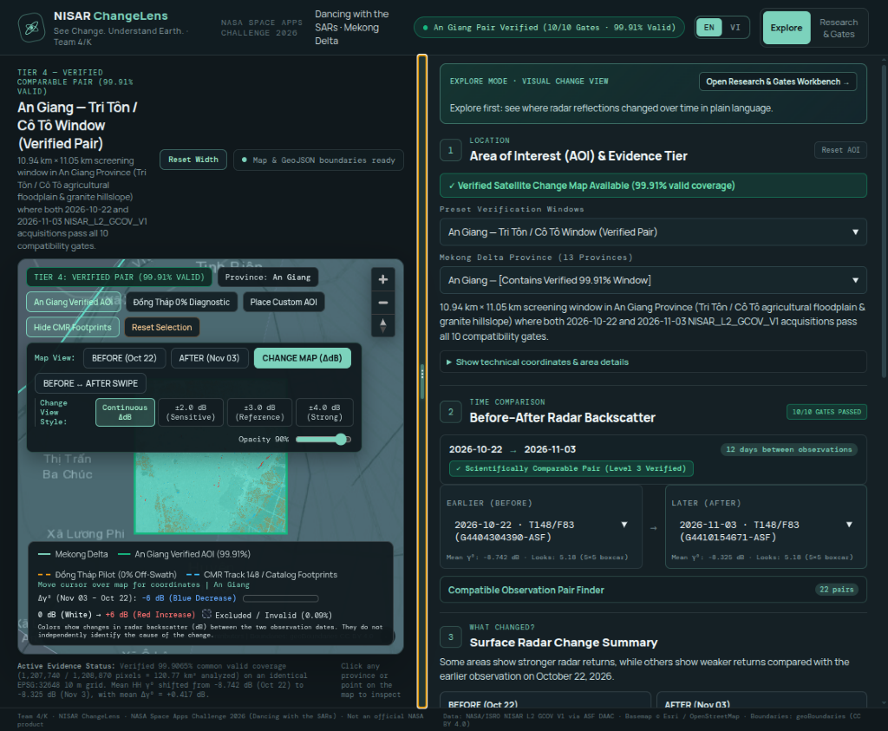
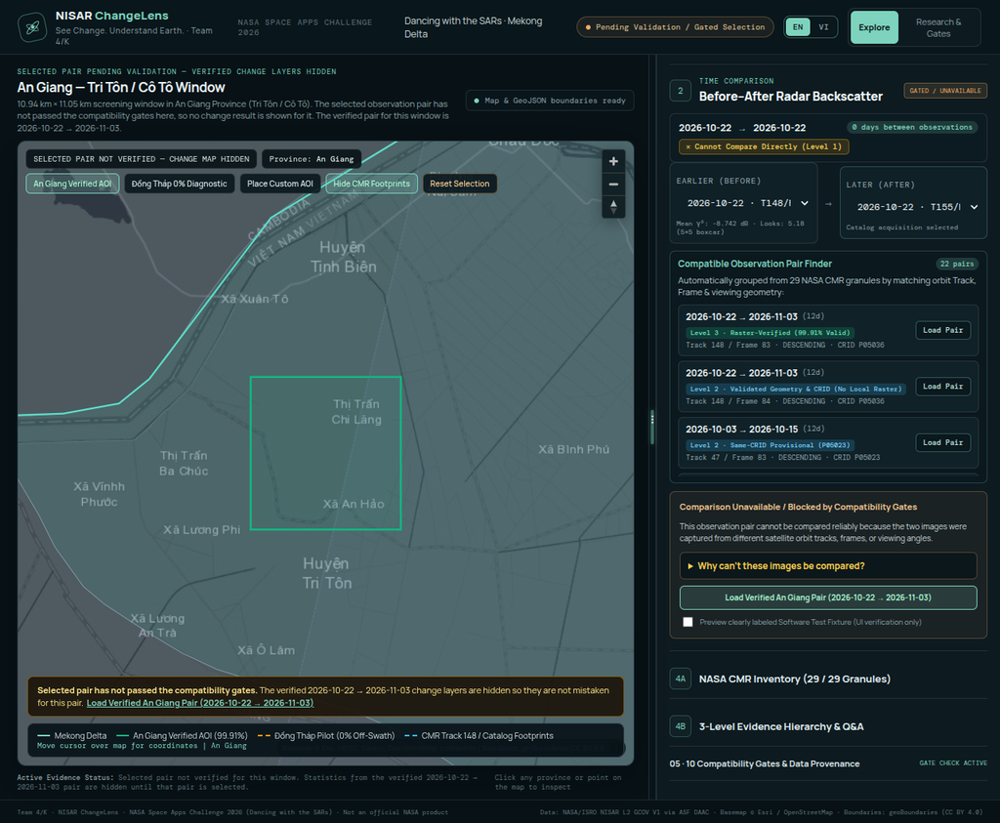
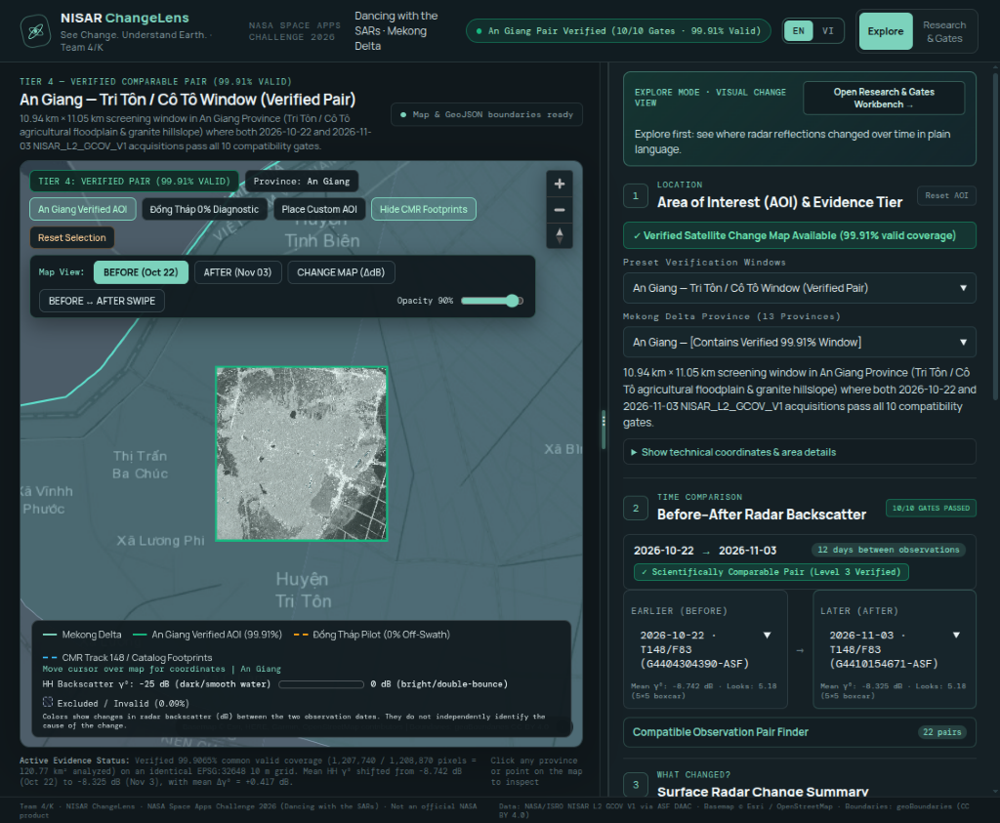
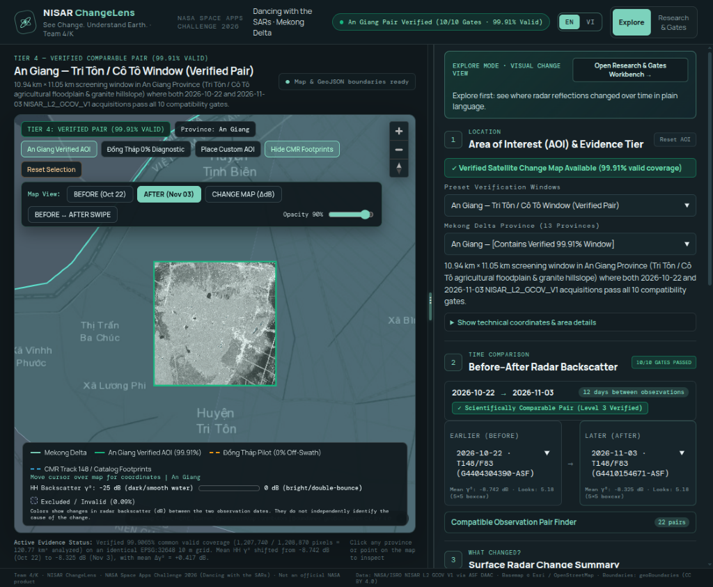
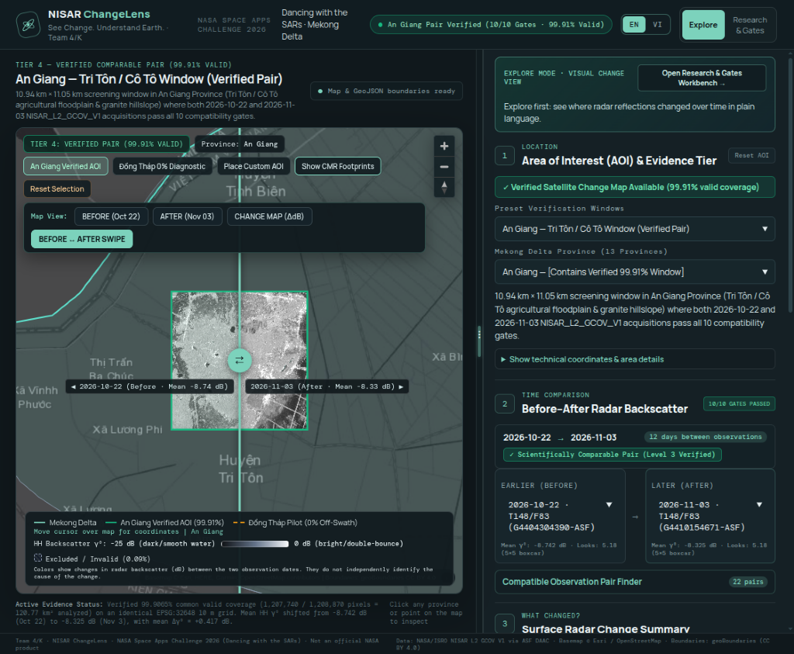
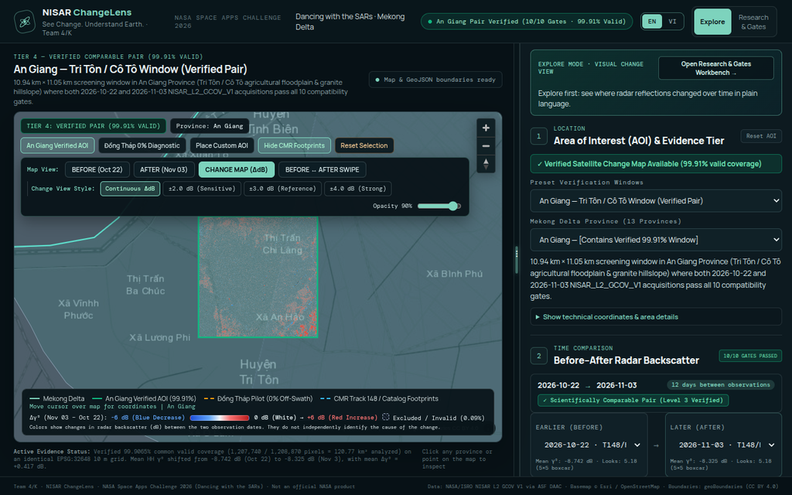
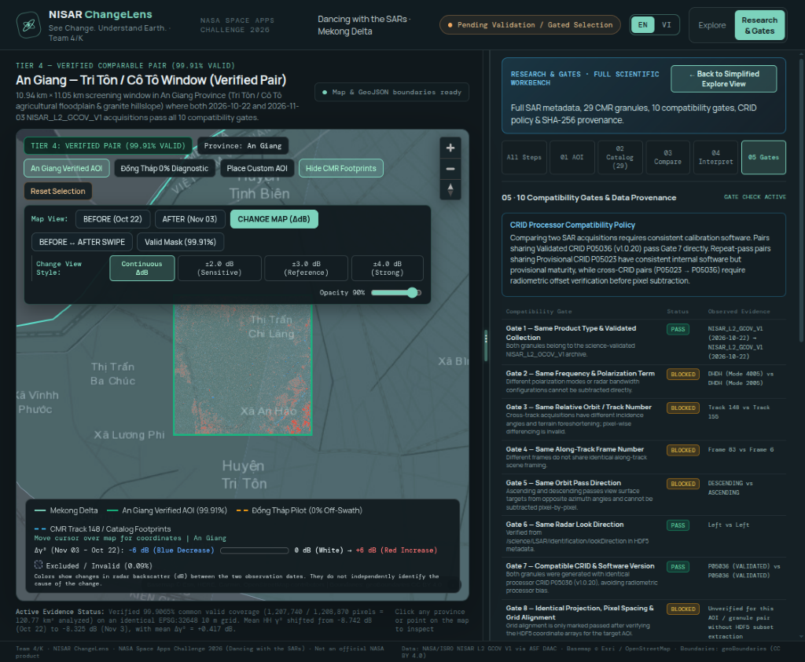

# NISAR ChangeLens — Complete User Guide

> **See Change. Understand Earth.** · *Nhìn Biến Động. Hiểu Trái Đất.*  
> **Team `4/K`** | **NASA Space Apps Challenge 2026 — *Dancing with the SARs***  
> **Repository**: https://github.com/4kShi/nisar-changelens

This guide walks new users, reviewers, and NASA Space Apps judges through installing, launching, and interpreting **NISAR ChangeLens** locally—even with no prior programming experience and without needing a NASA Earthdata account.

---

## Table of Contents

- [A. Project Overview](#a-project-overview)
- [B. System Requirements](#b-system-requirements)
- [C. Installation (Step-by-Step)](#c-installation-step-by-step)
- [D. How to Launch the Website (Development Mode)](#d-how-to-launch-the-website-development-mode)
- [E. Production Build & Preview](#e-production-build--preview)
- [F. How to Use NISAR ChangeLens](#f-how-to-use-nisar-changelens)
- [G. Understanding Scientific Results](#g-understanding-scientific-results)
- [H. Troubleshooting](#h-troubleshooting)
- [I. Important Limitations](#i-important-limitations)

---

## A. Project Overview

### What is NISAR ChangeLens?
**NISAR ChangeLens** is an interactive, bilingual (**English `EN` | Vietnamese `VI`**) web mapping workbench built to help people explore and understand surface changes captured by the **NASA-ISRO Synthetic Aperture Radar (NISAR)** satellite mission (`NISAR_L2_GCOV_V1`) in Vietnam's **Mekong Delta** (*Đồng bằng sông Cửu Long*).

### What problem does it solve?
1. **Clouds block optical satellites**: During monsoon and flood seasons in the Mekong Delta, optical sensors cannot see through thick cloud cover. L-band SAR (`~24 cm` wavelength) penetrates clouds day and night.
2. **Raw NISAR files are huge (`5.8–6.4 GB` each) and tilted**: A bounding-box search in NASA's catalog can say an image "covers" an area even when ~37% of the file edges are empty off-swath NoData (`mask = 255`). For example, our **Đồng Tháp Diagnostic Window (`[105.45, 10.60, 105.55, 10.70]`)** falls completely outside Track 148's valid radar swath (`0.00%` valid pixels) despite intersecting the catalog bounding box.
3. **Radar differences can be misinterpreted**: Subtracting uncalibrated images from different satellite tracks or calling every bright/dark pixel change "flooding" is scientifically invalid. NISAR ChangeLens enforces **10 automated compatibility gates** and presents changes visually first, with full technical evidence one click away.

### Who should use it?
- **General explorers, judges, students, and journalists** using **`Explore`** mode (*"Explore first. Understand change visually"*).
- **SAR researchers, hydrologists, and agricultural analysts** using **`Research & Gates`** mode to inspect metadata, CRID processor versions, compatibility gates, and SHA-256 checksums.

---

## B. System Requirements

| Requirement | Web Application (Required) | Optional Python Scientific Pipeline |
| :--- | :--- | :--- |
| **Operating System** | Windows 10/11, macOS, or Linux (Ubuntu/Debian/Fedora) | Windows 10/11, macOS, or Linux |
| **Runtime / Tools** | **Node.js `^20.19.0` or `>=22.12.0` LTS** + **npm** *(Node `22.12+` LTS recommended if running `npm test` via Vitest 5)* | **Python `3.12+`** (optional; not needed to run the web app) |
| **Frontend Stack** *(installed automatically)* | React `19.3.1`, MapLibre GL JS `6.18.0`, Vite `8.3.8`, TypeScript `7.0.2` | Dependencies listed in [`requirements.txt`](../requirements.txt) |
| **Backend Server** | **None required.** All web assets run directly in your browser. | None required |
| **NASA Earthdata Login** | **Not required.** Verified An Giang rasters & 29 CMR catalog records are pre-packaged locally. | Required only for live remote HDF5 re-extraction (`--execute`) |
| **Internet Connection** | **Optional** *(needed only to fetch background Esri Dark Gray basemap tiles & Google Fonts; GeoJSON boundaries and An Giang SAR overlays load 100% locally/offline)* | Required only when downloading packages or querying NASA CMR/ASF Cloud |
| **Hardware** | Modern browser with WebGL support (Chrome, Edge, Firefox, or Safari), `>= 4 GB` RAM, `~300 MB` free disk space | `>= 4 GB` RAM |

---

## C. Installation (Step-by-Step)

You can download the source code either as a ZIP archive from GitHub or using `git`.

### Option 1: Download ZIP from GitHub (No Git knowledge required)
1. Open the GitHub repository in your browser:  
   **https://github.com/4kShi/nisar-changelens**
2. Click the green **`<> Code`** button near the top right, then click **`Download ZIP`**.
3. Extract (unzip) the downloaded archive to a folder on your computer (for example on Desktop or in Documents).
4. Open a terminal inside the extracted project folder:
   - **Windows**: Open the extracted folder in File Explorer, type `cmd` or `powershell` in the address bar, and press **Enter**.
   - **macOS**: Right-click the extracted folder $\rightarrow$ **New Terminal at Folder**.
   - **Linux**: Right-click inside the folder $\rightarrow$ **Open in Terminal**.

### Option 2: Clone with Git
```bash
git clone https://github.com/4kShi/nisar-changelens.git
cd nisar-changelens
```

### Install Frontend Dependencies
Move into the `frontend` folder and install all packages from [`frontend/package-lock.json`](../frontend/package-lock.json):

```bash
cd frontend
npm install
```

> Wait for `npm install` to finish (it usually takes 15–45 seconds). No backend installation or database setup is needed.

---

## D. How to Launch the Website (Development Mode)

Once `npm install` completes inside `frontend/`:

1. Make sure your terminal prompt is inside the **`frontend`** directory (`.../nisar-changelens/frontend`).
2. Start the Vite development server:

```bash
npm run dev
```

3. Look at the terminal output. Vite will display the exact local URL, typically:

```text
  VITE v8.3.8  ready in ... ms

  ➜  Local:   http://localhost:5173/
  ➜  Network: use --host to expose
```

4. Hold `Ctrl` (`Cmd` on macOS) and click the URL, or copy **`http://localhost:5173/`** into Chrome, Firefox, Edge, or Safari.
5. **To stop the server** when you are finished: return to the terminal window and press **`Ctrl + C`**.

---

## E. Production Build & Preview

If you want to verify the optimized production bundle (the exact static files ready for hosting on GitHub Pages, Vercel, or Netlify), run these commands from inside **`frontend/`**:

```bash
npm run build
npm run preview
```

- `npm run build` runs `tsc -b && vite build` (TypeScript verification + production bundle generation into `frontend/dist/`).
- `npm run preview` serves the compiled static site locally and prints the preview address—typically **`http://localhost:4173/`** (or **`http://127.0.0.1:4173/`** if you run `npm run preview -- --port 4173 --host 127.0.0.1`).
- Press **`Ctrl + C`** in the terminal to stop the preview server.

---

## F. How to Use NISAR ChangeLens

Follow these 12 steps to explore everything NISAR ChangeLens offers:

### 1. Start in `Explore` Mode (Visual-First)
When the page opens, **Explore** mode is selected in the top-right header (`Explore | Research & Gates`), and the verified **An Giang — Tri Tôn / Cô Tô Window** is loaded automatically.  
The top status pill turns green: **`An Giang Pair Verified (10/10 Gates · 99.91% Valid)`**.  
*(Tip: Click **`VI`** in the top-right `EN | VI` toggle at any time to switch the entire interface to Vietnamese without losing your place.)*


### 2. Explore the Mekong Delta Map
- Drag to pan, scroll to zoom, or use the `+ / - / Compass` buttons on the upper-right corner of the map.
- Move your cursor across the map to see live **Latitude / Longitude** coordinates in the bottom legend bar.
- Toggle **`Hide CMR Footprints` / `Show CMR Footprints`** in the top-left Map HUD to inspect the tilted NASA satellite swath polygons across the Mekong Delta.
- You can also drag the **vertical splitter bar (`⋮`)** between the map and the right-hand panel to widen or narrow the sidebar (`Reset Width` appears in the toolbar to restore the `440px` default).



### 3. Choose a Study Location (**Section 1: Location**)
Use the **Preset Verification Windows** or **Mekong Delta Province (13 Provinces)** dropdown—or click any province directly on the map:
- **An Giang — Tri Tôn / Cô Tô Window (Verified Pair)**: `120.77 km²` analyzed area with `99.91%` valid pixels (`Level 3 / Tier 4` ready).
- **Đồng Tháp — Pilot Bbox (0% Valid Diagnostic)**: Demonstrates our **fail-closed scientific guard** where `100%` of the subset pixels have `mask = 255` (outside the radar swath).
- **Mekong Delta Regional Overview / Custom AOI (`Place Custom AOI`)**: Shows live catalog footprint overlap (`Tier 1–2`) without fabricating radar rasters.

### 4. Inspect or Switch Observation Pairs (**Section 2: Time Comparison**)
- By default, the verified pair **`2026-10-22` (`G4404304390-ASF`) $\rightarrow$ `2026-11-03` (`G4410154671-ASF`)** (`12 days between observations`) is loaded.
- Expand **Compatible Observation Pair Finder (`22 pairs`)** to browse all **22 repeat-pass pairs** automatically discovered from the 29 real NASA CMR granules across Tracks `148, 047, 083, 155`.
- Try selecting a **Level 2 candidate** or an **incompatible cross-track pair** to see how Explore mode clearly explains why pixel subtraction is unavailable (`"Why can't these images be compared?"`), then click the button to restore the verified An Giang pair in one click.



### 5. View `BEFORE (Oct 22)`
In the Map HUD bar (or Section 3 **What Changed?**), click **`BEFORE (Oct 22)`** to inspect the grayscale HH radar backscatter ($\gamma^0_{\text{dB}}$) from October 22, 2026 (`mean = -8.742 dB`). Dark areas represent smooth/wet low-return surfaces; bright areas represent strong double-bounce or rough scatterers.



### 6. View `AFTER (Nov 03)`
Click **`AFTER (Nov 03)`** to inspect the calibrated acquisition 12 days later (`mean = -8.325 dB`). Notice the bright parcels that intensified in the southeastern agricultural plain.



### 7. Switch to `CHANGE MAP (ΔdB)`
Click **`CHANGE MAP (ΔdB)`** to view the pixel-by-pixel backscatter difference ($\Delta\gamma^0 = \gamma^0_{\text{Nov 03}} - \gamma^0_{\text{Oct 22}}$).
- **Blue areas (`≤ -3 dB`)**: Radar backscatter decreased (e.g., smoother/wetter surface or vegetation removal).
- **Neutral/White (`within ±3 dB`)**: Stable or minor variation (`116.09 km²` / `96.13%`).
- **Red areas (`≥ +3 dB`)**: Radar backscatter increased (`4.39 km²` / `3.63%`).

### 8. Test `BEFORE ↔ AFTER SWIPE`
Click **`BEFORE ↔ AFTER SWIPE`** to split the map itself: October 22 (Before) is on the left of the divider and November 3 (After) on the right. Drag the round **⇄** handle left and right (or focus it and use the arrow keys, `Home` / `End`) to reveal where the surface changed. You can zoom and pan while swiping; both dates stay pixel-aligned.



### 9. Switch Exploratory Change Thresholds (`±2.0 dB`, `±3.0 dB`, `±4.0 dB`)
In the **Change View Style** bar (on the map HUD or in Section 3), compare:
- **`Continuous ΔdB`**: Smooth diverging color scale from `-6 dB` (blue) to `+6 dB` (red).
- **`±2.0 dB (Sensitive)`**: Exploratory view highlighting subtle/moderate shifts alongside residual speckle (`1.26 km²` decrease, `11.05 km²` increase).
- **`±3.0 dB (Reference)`**: The verified scientific reference baseline (`0.29 km²` decrease, `116.09 km²` stable, `4.39 km²` increase).
- **`±4.0 dB (Strong)`**: Exploratory view isolating only the strongest shifts (`0.10 km²` decrease, `1.78 km²` increase).



### 10. Adjust Layer Opacity
Drag the **`Opacity`** slider (`10%–100%`) on the Map HUD to blend the radar overlay with the underlying commune/district basemap labels. Click **`Reset (90%)`** to snap back to default opacity.

### 11. Read Plain-Language Summaries & Statistics
In **Section 3 (What Changed?)**, read the color-coded summary cards explaining the exact area (`km²`) and percentage (`%`) for decreases, stable terrain, and increases. Expand **Change Statistics & Numerical Breakdown** (in Section 4) for `mean (+0.417 dB)`, `median (+0.240 dB)`, `5th–95th percentile (-1.186 to +2.663 dB)`, and standard deviation (`1.277 dB`).

### 12. Open `Research & Gates` for Full Scientific Provenance
Click **`Research & Gates`** in the top-right header (or **`Open Research & Gates Workbench →`**) to reveal:
- The 5-step quick navigation bar (`All Steps`, `01 AOI`, `02 Catalog (29)`, `03 Compare`, `04 Interpret`, `05 Gates`).
- The **4-Tier Scientific Evidence Ladder** and **Valid Mask (99.91%)** raster button.
- Filterable inventory of all **29 authentic NASA CMR granules** (`Validated` vs `Provisional`, Track filter `148 / 047 / 083 / 155`).
- The **CRID Processor Compatibility Policy (`P05036` vs `P05023`)**, complete **10-Gate Verification Table**, **250 MB HTTP Range Byte-Budget Ledger (`13.53%` used)**, and **SHA-256 checksums** for all 11 verified outputs.



---

## G. Understanding Scientific Results

| Term / Concept | Plain-Language Explanation |
| :--- | :--- |
| **Gamma-0 Power ($\gamma^0_{\text{linear}}$)** | The raw linear radar energy reflected back to the NISAR satellite per unit area on the ground, stored in the `HHHH` covariance term after terrain/incidence normalization. |
| **Gamma-0 dB ($\gamma^0_{\text{dB}}$)** | Decibel logarithmic scale computed after a `5×5` boxcar speckle filter: $\gamma^0_{\text{dB}} = 10 \cdot \log_{10}(\overline{\text{HHHH}}_{5\times 5})$. Typical An Giang values are `-8.742 dB` (Oct 22) and `-8.325 dB` (Nov 3). |
| **Delta Gamma-0 dB ($\Delta\gamma^0_{\text{dB}}$)** | The calibrated difference between two dates: $\Delta\gamma^0 = \gamma^0_{\text{Later}} - \gamma^0_{\text{Earlier}}$. Over the An Giang window, the mean shift is `+0.417 dB`. |
| **Negative Change ($\Delta\gamma^0 < 0$, Blue)** | Radar returns became **weaker** on Nov 3 than Oct 22. Often occurs when standing open water acts like a mirror (specular reflection away from the radar), soil dries out, or tall crops are harvested. |
| **Positive Change ($\Delta\gamma^0 > 0$, Red)** | Radar returns became **stronger** on Nov 3 than Oct 22. Often occurs with L-band **double-bounce scattering** (water flooding beneath emergent rice stems or wetland vegetation), denser canopy growth, or wetter rough soil. |
| **Valid Data Mask (`mask`)** | Quality flag inside NISAR HDF5 files. Values `0` or `255` mark invalid/off-swath pixels (`1,130` pixels or `0.09%` in An Giang are excluded; `100%` of the Đồng Tháp test window is `mask = 255`). |
| **Stable / Decrease / Increase Thresholds** | The verified scientific baseline classifies pixels using **$\pm 3.0\text{ dB}$** (`2×` linear power change after `5×5` filtering): `0.29 km²` decreased ($\le -3\text{ dB}$), `116.09 km²` stable (`±3 dB`), and `4.39 km²` increased ($\ge +3\text{ dB}$). The `±2.0 dB` and `±4.0 dB` options are exploratory display presets only. |
| **10 Compatibility Gates** | Ten strict checks verifying collection maturity, polarization, orbit track (`148`), frame (`083`), pass direction (`DESCENDING`), look side (`Left`), processor CRID (`P05036`), CRS/spacing (`EPSG:32648`, `10 m`), valid mask availability, and common pixel overlap (`99.91%`). |
| **Catalog Candidates vs. Raster-Verified Pairs** | Only **1 pair**—**An Giang `2026-10-22` (`G4404304390-ASF`) $\rightarrow$ `2026-11-03` (`G4410154671-ASF`)**—is **Level 3 Raster-Verified** with pre-extracted pixels (`1,207,740` common valid pixels). The **21 Level 2 pairs** found in the catalog are *geometrically compatible repeat-pass candidates* whose orbit/frame metadata match, **not** raster-verified Change Maps—they require running the Python HDF5 extractor with Earthdata credentials before pixel comparison can be computed. |

> **CRITICAL SCIENTIFIC CAUTION**: **Backscatter change ($\Delta\gamma^0_{\text{dB}}$) does NOT automatically prove flooding, drying, or land-use conversion.** Confirming physical cause requires independent optical imagery (e.g., Sentinel-2 NDWI), cross-polarized channels (`HV`/`VH`), local river/rain gauges, or field observations.

---

## H. Troubleshooting

| Issue | Likely Cause & Verified Solution |
| :--- | :--- |
| **`npm: command not found`** | Node.js/npm is not installed or not in your `PATH`. Install **Node.js 22 LTS** from [nodejs.org](https://nodejs.org/) (or activate via `nvm use 22`), close and reopen your terminal, and verify `node -v` and `npm -v`. |
| **Node.js version incompatible error during `npm install` / `npm run dev`** | Vite 8 requires Node `^20.19.0` or `>=22.12.0` (Vitest 5 requires `^22.12.0` or `>=24`). Upgrade Node.js to **v22.12+ LTS** and rerun `npm install`. |
| **`npm install` fails (network timeout or cache error)** | Check your Internet connection, then inside `frontend/` run `npm cache clean --force` and retry `npm install`. Do not delete `package-lock.json`. |
| **`Port 5173 is in use` or `Port 4173 is in use`** | Another terminal or preview server is still running, or another app uses that port. Either stop the old process (`Ctrl + C`) or specify a free port: `npm run dev -- --port 5174` or `npm run preview -- --port 4174 --host 127.0.0.1`. |
| **Browser cannot open `localhost`** | Confirm the terminal still shows Vite running (do not close the terminal while viewing the app). Copy the exact URL printed after `➜ Local:` (try `http://127.0.0.1:5173/` if `localhost` resolves strangely). |
| **Map background looks dark/blank or basemap warning appears** | Your machine is offline or blocked from reaching Esri tile servers (`server.arcgisonline.com`). **This is normal offline**: all local Mekong Delta GeoJSON boundaries and verified An Giang SAR overlays still render and function normally over the dark map canvas. |
| **WebGL / map canvas fails to render** | Enable hardware acceleration in your browser settings or try Chrome/Firefox/Edge with WebGL enabled. |
| **GeoJSON or PNG overlays fail to load (`Boundary error`)** | Make sure you launched Vite via `npm run dev` or `npm run preview` from inside `frontend/`—never open `frontend/index.html` directly via `file://` in a browser, as browsers block `fetch()` over `file://`. |

---

## I. Important Limitations

1. **Scope of Verified Pixel Data**: Pixel-level calibrated results exist **only** for the `120.77 km²` **An Giang window (`[104.95, 10.45, 105.05, 10.55]`)** (`2026-10-22` $\rightarrow$ `2026-11-03`, `99.91%` valid) and the `0.00%` valid off-swath diagnostic check in **Đồng Tháp (`[105.45, 10.60, 105.55, 10.70]`)**. None of the **21 Level 2 geometric candidates** or remaining 11 provinces should be treated as raster-verified Change Maps.
2. **Internet-Dependent Visual Elements**: Background cartographic basemap tiles (`Esri World Dark Gray`) and web fonts (`Google Fonts`) require Internet access. All scientific boundaries, catalog records, 10-gate checks, and verified An Giang rasters work 100% offline/locally.
3. **Single Polarization & No Ground Validation Yet**: This release analyzes calibrated `HHHH` backscatter (`10 m` grid) and includes methodological notes (`W-1` mask edge `<= 0.01 km²`, `W-2` Jensen `~1.05 dB` smoothing offset) documented in [`FINAL_SCIENTIFIC_QA.md`](FINAL_SCIENTIFIC_QA.md) and [`LIMITATIONS.md`](LIMITATIONS.md). Cross-pol `HV`/`VV` and ground truth are not yet integrated.
4. **Remote HDF5 Re-Extraction**: The web app requires **no credentials**. Only re-running `pipeline/extract_verified_pair.py --execute` against ASF Earthdata Cloud requires a personal NASA Earthdata Login (`~/.netrc`).
